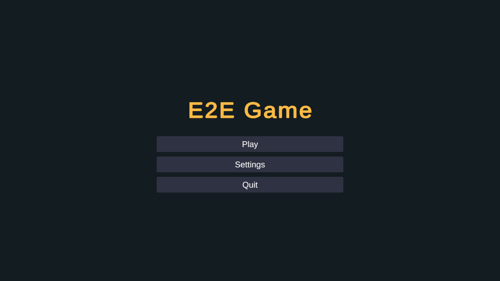
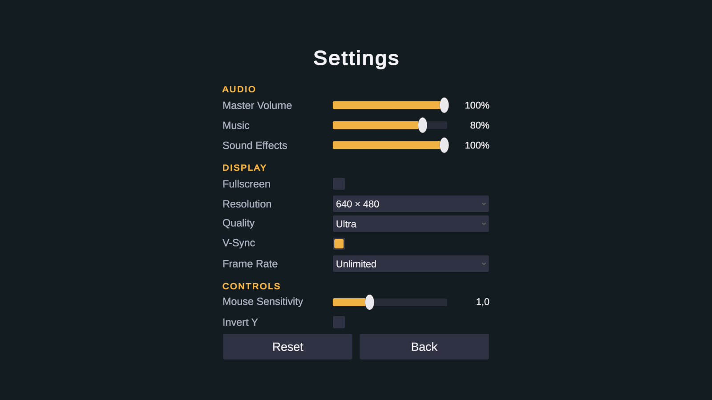
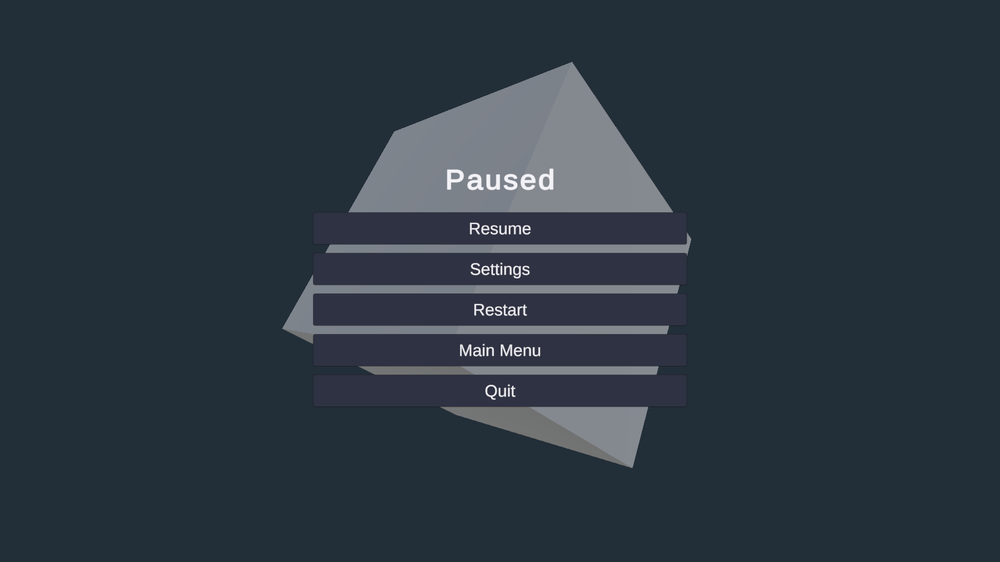

# Menu System

**uGUI menus for Unity 6**: screens with transitions and a working Back button, a pause menu, a
settings screen that saves itself, "Are you sure?" dialogs and no-code buttons. Make a full menu in one
click, then give it your own look, or use the components on menus you design yourself.

[English](#english) · [Türkçe](#türkçe)

| Main menu | Settings | Pause menu |
|---|---|---|
|  |  |  |

---

<a name="english"></a>
# English

- **Screens like pages**: `Open(settings)` goes forward, **Back / Escape / gamepad B** goes back to where
  you were, with the same button selected again. Fade, scale or slide transitions in real time.
- **Keyboard and gamepad** work out of the box: the first button is selected when a screen opens.
- **Pause menu**: Escape / Start pauses (time, sound, cursor), Escape again goes back or resumes.
- **Settings that save themselves**: Master / Music / SFX volume, fullscreen, resolution, quality, V-Sync,
  frame rate limit, mouse sensitivity, invert Y. Saved in PlayerPrefs and applied when the game starts.
- **Confirm dialog**: `ConfirmDialog.Ask("Quit?", Application.Quit)`, or tick **Confirm** on a button.
- **Menu Button**: Open Screen, Back, Resume, Load Scene, Restart, Quit, Reset Settings, without code.
- **One-click templates**: **GameObject > Atthree > Menus > Main Menu / Pause Menu / Settings Screen**.
  They are normal uGUI objects (Canvas, Image, Button, TextMeshPro) you can restyle freely.
- Works with the other Atthree packages if they're installed: **Scene Loader** (scene loads fade),
  **Audio Manager** (volume sliders control its channels). Also works with your own **Audio Mixer**.

**Requirements:** Unity 6 (6000.0+), uGUI + TextMeshPro (installed by default). The Input System package
is optional, both input systems work.

## Step-by-step

### 1. Add the package

**Window > Package Manager** → **+** → **Install package from git URL…** →

```
https://github.com/Atthree/MenuSystem.git
```

To lock a version: `https://github.com/Atthree/MenuSystem.git#v0.1.0`

### 2. A main menu in one click

1. Open your menu scene. **Hierarchy** → right click → **Atthree > Menus > Main Menu**.
   (The first time Unity asks to import **TextMeshPro Essentials**: click **Import**.)
2. A **Main Menu** Canvas appears with three screens: **Main** (Play, Settings, Quit), **Settings** and a
   **Confirm Dialog**, plus an **EventSystem** if the scene had none.
3. Select **Main > Content > Play Button** → in **Menu Button** pick your game scene in **Scene**
   (the list shows the scenes in the build list).
4. Press **Play**. Try the mouse, the keyboard (arrows + Enter) and Escape.

### 3. A pause menu in one click

1. Open your game scene. **Hierarchy** → right click → **Atthree > Menus > Pause Menu**.
2. On **Main Menu Button**, check that **Scene** is your menu scene.
3. Play and press **Escape** (or Start on a gamepad).

The pause menu is hidden while you edit. To work on it: select the **Pause Menu** Canvas → in the
**Menu Manager** inspector click **Show Only This** next to a screen.

### 4. Give it your own look

The templates are only a starting point. Everything is a normal uGUI object:

| To change | Where |
|---|---|
| Background color / image | The screen's **Image** (e.g. **Main**). Put your own sprite in **Source Image**. |
| Buttons | Each **… Button**: its **Image** (sprite, color) and **Button > Colors** (normal, highlighted, pressed). Or delete them and drag in your own buttons. |
| Font, size, color of texts | The **TextMeshPro** texts. Change one, or set your font in **Project Settings > TextMesh Pro**. |
| Title | **Main > Content > Title** (a text; replace it with an **Image** for a logo). |
| Layout | **Content** has a **Vertical Layout Group**: spacing, padding, alignment. Move or resize **Content** to put the menu at the left, right… |
| Transition | The screen's **Menu Screen > Transition** and **Duration**. |

Want more screens (Credits, Level Select, Extras)? Right click the Canvas → **Atthree > Menus > Empty
Screen**, put your content in it, and on a button choose **Menu Button > Open Screen** → that screen.

### 5. Or use the components on a menu you made yourself

Already have a Canvas with your own panels and buttons? Add the components to it:

1. **Canvas** → **Add Component** → **Menu Manager**. Drag your first panel into **Start Screen**.
2. Every **panel** (page) → **Add Component** → **Menu Screen**. (It adds a CanvasGroup.)
3. Every **button** → **Add Component** → **Menu Button** → choose the action:

| Button | Action |
|---|---|
| Play | `Load Scene` → your game scene |
| Settings / Credits / Level Select | `Open Screen` → that panel |
| Back | `Back` |
| Resume (pause menu) | `Resume` |
| Restart | `Restart Scene` |
| Main Menu | `Load Scene` → your menu scene |
| Quit | `Quit` (tick **Confirm** to ask first) |
| Reset settings | `Reset Settings` |

4. **Settings**: on your own **Slider**, **Toggle** or **Dropdown** (uGUI or TextMeshPro) → **Add Component**
   → **Setting Control** → choose the **Setting**. It shows the saved value, saves changes and fills
   dropdowns (resolutions, quality levels, frame rates) by itself. Drag a text into **Value Label** to
   show "80%".
5. **Pause**: on the pause Canvas add **Pause Menu**, and drag your pause panel into **Pause Screen**.
   Leave the Menu Manager's **Start Screen** empty.
6. **"Are you sure?"**: make a panel with a question text and two buttons → **Menu Screen** + **Confirm
   Dialog** → drag the text, Yes and No into its fields. Every **Menu Button** with **Confirm** ticked uses it.

> Make sure the scene has an **EventSystem** (GameObject > UI > Event System), otherwise clicks don't work.

### 6. From code

```csharp
using Atthree.Menus;
using UnityEngine;

public class GameOver : MonoBehaviour
{
    public MenuManager menu;
    public MenuScreen gameOverScreen;

    public void Show()                       => menu.Open(gameOverScreen);
    public void AskQuit()                    => ConfirmDialog.Ask("Quit to desktop?", MenuButton.QuitGame);
    public void ToMainMenu()                 => MenuButton.LoadScene("MainMenu");  // fades if Scene Loader is installed
}
```

```csharp
// read settings in your own scripts
float sensitivity = GameSettings.MouseSensitivity;
if (GameSettings.InvertY) lookY = -lookY;
GameSettings.Changed += s => { if (s == Setting.MouseSensitivity) UpdateCamera(); };

// pause from code (cutscenes, inventory)
FindAnyObjectByType<PauseMenu>().CanPause = false;
if (PauseMenu.IsPaused) return;

// your own input actions for back / pause
MenuInput.BackPressed  = () => myActions.UI.Cancel.WasPressedThisFrame();
MenuInput.PausePressed = () => myActions.Player.Pause.WasPressedThisFrame();
```

## Where to use it

| Game | Use |
|---|---|
| Any game | Main Menu template → change colors and font → done |
| Games you pause | Pause Menu template; `PauseMenu.IsPaused` in your player scripts |
| PC games | The settings screen: resolution, fullscreen, quality, V-Sync, FPS limit |
| Console-style / gamepad | Selection and Back work with the gamepad from the start |
| Menus with many pages | Screens + Open Screen buttons; Back always knows the way |

## Volume: where does it go?

1. **Atthree Audio Manager installed** → the sliders set its Master / Music / Sfx channels (it saves them).
2. Otherwise, an **Audio Mixer** in the **Menu Manager**'s **Audio Mixer** field → the sliders set the
   exposed parameters **MasterVolume**, **MusicVolume**, **SfxVolume** (in dB). In the mixer: right click a
   group's Volume → *Expose…*, then rename the parameter in **Exposed Parameters**.
3. Otherwise **Master** sets `AudioListener.volume`; Music / SFX are saved and you read them with
   `GameSettings.MusicVolume`.

## Good to know

- **Only the last opened menu reacts to Back**, so a pause menu and a dialog on another Canvas don't both
  go back at once.
- The pause menu keeps the time scale it found and puts it back on resume. A scene load with the Scene
  Loader un-pauses automatically.
- Resolution and fullscreen are only applied in builds (not in the editor's Game view).
- Setting values are saved under `Atthree.Settings.*` in PlayerPrefs. `GameSettings.ResetAll()` clears them.
- In the editor only one screen is shown at runtime; use **Show Only This** in the Menu Manager to edit
  hidden screens.

## Troubleshooting

| Problem | Fix |
|---|---|
| Clicks do nothing | Add an **EventSystem** (GameObject > UI > Event System). With the Input System package it needs an **Input System UI Input Module**. |
| Texts are invisible | Import **TextMeshPro Essentials** (Window > TextMeshPro > Import TMP Essential Resources). |
| Escape doesn't pause | **Pause With Button** on the Pause Menu, and **Can Pause** not turned off by your code. |
| Play does nothing | Choose a scene in the Play button's **Scene**, and add it to the build list. |
| Volume sliders do nothing | See *Volume: where does it go?* above. |
| A screen I edited is hidden in Play | Only the **Start Screen** is shown at the start; others open with a Menu Button or `Open`. |

## How it works

- `MenuManager` keeps a stack of open screens. `Open` hides the top one (unless the new one is an overlay)
  and pushes; `Back` pops and shows the previous one; on the first screen it calls `onBackAtRoot`
  (the pause menu resumes there).
- `MenuScreen` animates a CanvasGroup (alpha, scale, position) with unscaled time, turns off input while
  hidden, deactivates the object when hidden and remembers the selected button.
- `GameSettings` caches values, saves to PlayerPrefs, applies them to Screen / QualitySettings / audio,
  and raises `Changed`, which `SettingControl` listens to.

## Tests

25 tests. PlayMode (21): start screen and selection, open/back stack, Back button and root event, selection
restored, overlays, transitions in real time while paused, open by name, only the last menu handles Back,
pause/resume of time, audio and cursor, Escape from a sub-screen, gamepad Start, blocking pause, cleanup
when destroyed, Menu Button actions, Confirm Dialog yes/no/Escape, confirm before an action, setting
controls (slider, toggle, dropdown), saving/clamping/reset, volume, options, TMP and legacy texts.
EditMode (4): TextMeshPro import, Main Menu, Settings and Pause Menu templates.
Tested with and without the Input System, Scene Loader and Audio Manager.

To run them, add to `Packages/manifest.json`:

```json
"testables": [ "com.atthree.menu-system" ]
```

then **Window > General > Test Runner > PlayMode / EditMode > Run All**.

## License

[MIT](LICENSE.md)

---

<a name="türkçe"></a>
# Türkçe

- **Sayfa gibi ekranlar**: `Open(settings)` ileri gider, **Back / Escape / gamepad B** geldiğin yere döner,
  aynı buton yine seçili olur. Gerçek zamanlı fade, scale ya da slide geçişleri.
- **Klavye ve gamepad** hemen çalışır: ekran açılınca ilk buton seçilir.
- **Duraklatma menüsü**: Escape / Start oyunu durdurur (zaman, ses, imleç), tekrar Escape geri gider ya da devam ettirir.
- **Kendini kaydeden ayarlar**: Master / Müzik / Efekt sesi, tam ekran, çözünürlük, kalite, V-Sync, FPS
  sınırı, fare hassasiyeti, Y eksenini ters çevir. PlayerPrefs'e kaydedilir, oyun açılınca uygulanır.
- **Onay penceresi**: `ConfirmDialog.Ask("Çıkılsın mı?", Application.Quit)`, ya da butonda **Confirm**'ü işaretle.
- **Menu Button**: Ekran aç, Geri, Devam, Sahne yükle, Yeniden başlat, Çık, Ayarları sıfırla. Kodsuz.
- **Tek tıkla şablonlar**: **GameObject > Atthree > Menus > Main Menu / Pause Menu / Settings Screen**.
  Hepsi normal uGUI objeleri (Canvas, Image, Button, TextMeshPro), istediğin gibi değiştirebilirsin.
- Kuruluysa diğer Atthree paketleriyle çalışır: **Scene Loader** (sahne geçişleri kararır), **Audio Manager**
  (ses kaydırıcıları onun kanallarını ayarlar). Kendi **Audio Mixer**'ınla da çalışır.

**Gereksinim:** Unity 6 (6000.0+), uGUI + TextMeshPro (varsayılan olarak kurulu). Input System paketi
isteğe bağlı, iki giriş sistemi de çalışır.

## Adım adım

### 1. Paketi ekle

**Window > Package Manager** → **+** → **Install package from git URL…** →

```
https://github.com/Atthree/MenuSystem.git
```

Sürüm sabitlemek için: `https://github.com/Atthree/MenuSystem.git#v0.1.0`

### 2. Tek tıkla ana menü

1. Menü sahneni aç. **Hierarchy** → sağ tık → **Atthree > Menus > Main Menu**.
   (İlk seferde Unity **TextMeshPro Essentials**'ı içe aktarmayı sorar: **Import**'a bas.)
2. **Main Menu** adında bir Canvas oluşur. İçinde üç ekran var: **Main** (Play, Settings, Quit), **Settings**
   ve **Confirm Dialog**. Sahnede yoksa bir **EventSystem** de eklenir.
3. **Main > Content > Play Button**'ı seç → **Menu Button**'daki **Scene** listesinden oyun sahneni seç
   (liste build listesindeki sahneleri gösterir).
4. **Play**'e bas. Fareyi, klavyeyi (oklar + Enter) ve Escape'i dene.

### 3. Tek tıkla duraklatma menüsü

1. Oyun sahneni aç. **Hierarchy** → sağ tık → **Atthree > Menus > Pause Menu**.
2. **Main Menu Button**'daki **Scene**'in menü sahnen olduğuna bak.
3. Play'e bas ve **Escape**'e (ya da gamepad'de Start'a) bas.

Duraklatma menüsü düzenlerken gizlidir. Üzerinde çalışmak için: **Pause Menu** Canvas'ını seç →
**Menu Manager** bölümünde bir ekranın yanındaki **Show Only This**'e bas.

### 4. Kendi tasarımını ver

Şablonlar sadece başlangıç. Hepsi normal uGUI objesi:

| Değiştirmek için | Nerede |
|---|---|
| Arka plan rengi / görseli | Ekranın **Image**'ı (örn. **Main**). Kendi sprite'ını **Source Image**'a koy. |
| Butonlar | Her **… Button**: **Image** (sprite, renk) ve **Button > Colors** (normal, üzerine gelince, basınca). Ya da silip kendi butonlarını sürükle. |
| Yazıların fontu, boyutu, rengi | **TextMeshPro** yazıları. Tek tek değiştir, ya da fontunu **Project Settings > TextMesh Pro**'dan varsayılan yap. |
| Başlık | **Main > Content > Title** (bir yazı; logo için yerine bir **Image** koy). |
| Yerleşim | **Content**'te **Vertical Layout Group** var: aralık, kenar boşluğu, hizalama. Menüyü sola/sağa almak için **Content**'i taşı ya da boyutlandır. |
| Geçiş | Ekranın **Menu Screen > Transition** ve **Duration** alanları. |

Başka ekran mı lazım (Jenerik, Bölüm Seçimi, Ekstralar)? Canvas'a sağ tık → **Atthree > Menus > Empty
Screen**, içine kendi içeriğini koy, bir butonda **Menu Button > Open Screen** → o ekran.

### 5. Ya da kendi yaptığın menüde bileşenleri kullan

Kendi panellerin ve butonlarınla hazır bir Canvas'ın mı var? Bileşenleri ekle:

1. **Canvas** → **Add Component** → **Menu Manager**. İlk panelini **Start Screen**'e sürükle.
2. Her **panel** (sayfa) → **Add Component** → **Menu Screen**. (CanvasGroup'u kendisi ekler.)
3. Her **buton** → **Add Component** → **Menu Button** → eylemi seç:

| Buton | Action |
|---|---|
| Oyna | `Load Scene` → oyun sahnen |
| Ayarlar / Jenerik / Bölüm Seçimi | `Open Screen` → o panel |
| Geri | `Back` |
| Devam (duraklatma menüsü) | `Resume` |
| Yeniden Başlat | `Restart Scene` |
| Ana Menü | `Load Scene` → menü sahnen |
| Çıkış | `Quit` (önce sorsun diye **Confirm**'ü işaretle) |
| Ayarları sıfırla | `Reset Settings` |

4. **Ayarlar**: kendi **Slider**, **Toggle** ya da **Dropdown**'ına (uGUI veya TextMeshPro) → **Add Component**
   → **Setting Control** → **Setting**'i seç. Kayıtlı değeri gösterir, değişiklikleri kaydeder, dropdown'ları
   (çözünürlükler, kalite seviyeleri, FPS seçenekleri) kendisi doldurur. "%80" göstermek için bir yazıyı
   **Value Label**'a sürükle.
5. **Duraklatma**: duraklatma Canvas'ına **Pause Menu** ekle, duraklatma panelini **Pause Screen**'e sürükle.
   Menu Manager'ın **Start Screen**'ini boş bırak.
6. **"Emin misin?"**: bir soru yazısı ve iki butonlu bir panel yap → **Menu Screen** + **Confirm Dialog** →
   yazıyı, Yes ve No butonlarını alanlarına sürükle. **Confirm**'ü işaretli her **Menu Button** bunu kullanır.

> Sahnede **EventSystem** olmalı (GameObject > UI > Event System), yoksa tıklamalar çalışmaz.

### 6. Koddan

İngilizce bölümdeki örnekler aynen geçerli: `menu.Open(ekran)`, `ConfirmDialog.Ask(...)`,
`MenuButton.LoadScene("MainMenu")`, ayarları okumak için `GameSettings.MouseSensitivity` /
`GameSettings.InvertY`, duraklatmayı engellemek için `PauseMenu.CanPause = false`, kendi input
action'ların için `MenuInput.BackPressed` / `MenuInput.PausePressed`.

## Ses ayarı nereye gider?

1. **Atthree Audio Manager kuruluysa** → kaydırıcılar onun Master / Music / Sfx kanallarını ayarlar (kaydı o yapar).
2. Değilse, **Menu Manager**'ın **Audio Mixer** alanında bir mixer varsa → kaydırıcılar dışa açılmış
   **MasterVolume**, **MusicVolume**, **SfxVolume** parametrelerini ayarlar (dB). Mixer'da: grubun Volume'üne
   sağ tık → *Expose…*, sonra **Exposed Parameters**'tan adını değiştir.
3. Hiçbiri yoksa **Master** `AudioListener.volume`'u ayarlar; Müzik / Efekt kaydedilir, sen
   `GameSettings.MusicVolume` ile okursun.

## Bilmekte fayda var

- **Back'e sadece en son açılan menü tepki verir**: başka Canvas'taki duraklatma menüsü ve pencere aynı anda geri gitmez.
- Duraklatma menüsü bulduğu zaman ölçeğini saklar, devam edince geri koyar. Scene Loader ile sahne yüklenince duraklatma kendiliğinden kalkar.
- Çözünürlük ve tam ekran sadece build'de uygulanır (editörün Game penceresinde değil).
- Ayarlar PlayerPrefs'te `Atthree.Settings.*` altında. `GameSettings.ResetAll()` hepsini siler.

## Sorun giderme

| Sorun | Çözüm |
|---|---|
| Tıklamalar çalışmıyor | **EventSystem** ekle (GameObject > UI > Event System). Input System paketiyle **Input System UI Input Module** gerekir. |
| Yazılar görünmüyor | **TextMeshPro Essentials**'ı içe aktar (Window > TextMeshPro > Import TMP Essential Resources). |
| Escape duraklatmıyor | Pause Menu'de **Pause With Button** açık olmalı, kodun **Can Pause**'u kapatmamış olmalı. |
| Play bir şey yapmıyor | Play butonunun **Scene**'inde bir sahne seç, sahneyi build listesine ekle. |
| Ses kaydırıcıları etki etmiyor | Yukarıdaki *Ses ayarı nereye gider?* bölümüne bak. |
| Düzenlediğim ekran Play'de gizli | Başta sadece **Start Screen** görünür; diğerleri Menu Button ya da `Open` ile açılır. |

## Testler

25 test (21 PlayMode, 4 EditMode). Input System, Scene Loader ve Audio Manager varken ve yokken denendi.
Çalıştırmak için `Packages/manifest.json` içine `"testables": [ "com.atthree.menu-system" ]` ekle, sonra
**Window > General > Test Runner > PlayMode / EditMode > Run All**.

## Lisans

[MIT](LICENSE.md)

---

🤖 *This project was developed with the help of AI tools.*  
🤖 *Bu proje yapay zekâ araçlarının yardımıyla geliştirilmiştir.*
